<div align="center">



# 23050111-CMD // TACTICAL OPERATOR

**DEVELOPER • AI EXPLORER • PROBLEM SOLVER**

  

*LOCK IN. THINK FAST. SHIP CLEAN CODE.*

</div>

---

## `01 // LIVE COMBAT SIMULATION`



> **SIMULATION ONLY** — Decorative SVG animations inspired by tactical FPS games. No real shooting controls are available in GitHub README.

## `02 // UTILITY DEPLOYMENT`

<table>
<tr><td width="50%"></td><td width="50%"></td></tr>
</table>

## `03 // OPERATOR LOADOUT`

```yaml
operator: 23050111-cmd
role: Student / Developer
specialties:
  - Python and AI experiments
  - Web development
  - Git and GitHub collaboration
status: LEARNING // BUILDING // IMPROVING
```

<div align="center">


</div>

## `04 // MISSION BOARD`

| MISSION | OBJECTIVE | LINK |
|:--|:--|:--|
| **STAIN RECOGNITION** | CNN-based image classification project | [Open repository](https://github.com/23050111-cmd/hethongnhandienvetban) |
| **OPERATOR HQ** | GitHub profile and developer activity | [Open profile](https://github.com/23050111-cmd) |

<details>
<summary><b>▶ OPEN CLASSIFIED MISSION BRIEF</b></summary>

### Current objectives

- Improve image classification reliability with clean datasets and validation.
- Build maintainable applications and reusable components.
- Document projects, experiments and results.

**MISSION PROTOCOL:** `ANALYZE → BUILD → TEST → DEPLOY`

</details>

<details>
<summary><b>▶ VIEW COMBAT LOG / GITHUB ACTIVITY</b></summary>

[](https://github.com/23050111-cmd)

</details>

## `05 // EXTRACTION POINT`

<div align="center">

[](https://github.com/23050111-cmd?tab=repositories)
[](https://github.com/23050111-cmd)

**`MISSION COMPLETE // READY FOR NEXT ROUND`**

<sub>Fan-made tactical FPS aesthetic. Not affiliated with Valve or Counter-Strike.</sub>

</div>
