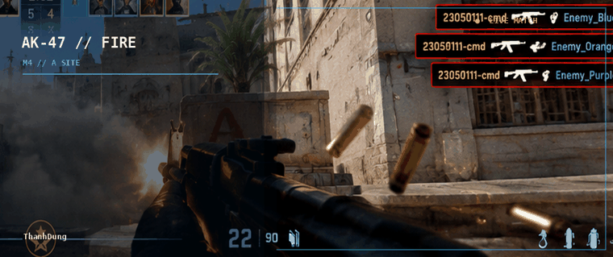
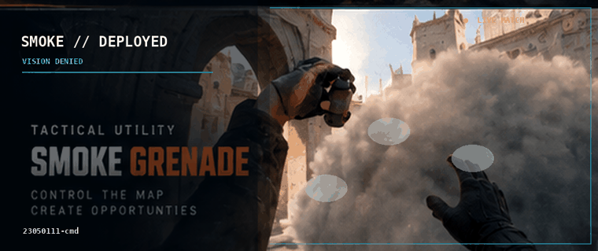
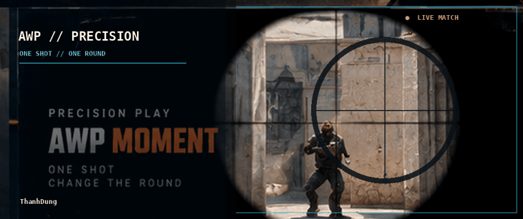
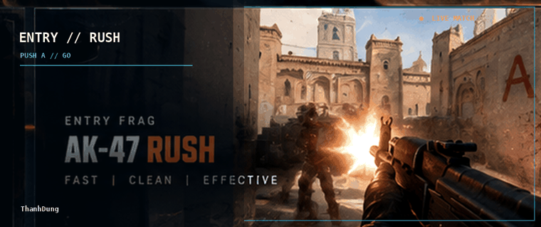

# ThanhDung  |  TACTICAL DEV

**CODE • PLAY • IMPROVE • REPEAT**

> Four independent animated scenes — no collage.

## 01 — AK-47 FIRE

## 02 — SMOKE GRENADE

## 03 — AWP SCOPE

## 04 — ENTRY RUSH

---

### TECH STACK
Python • PHP • C# • C++ • MySQL • Git • GitHub • VS Code

[GitHub](https://github.com/23050111-cmd)

<!--
All scenes are independently supplied as both animated SVG and GIF.
The GIF is the default for predictable GitHub playback.
To test an SVG, replace .gif with .svg in the image paths.
The backgrounds are original AI-generated artwork, not actual Counter-Strike 2 gameplay captures.
-->
